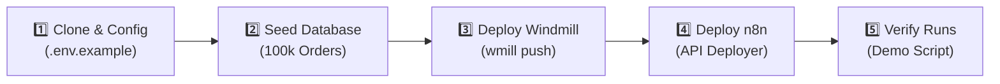
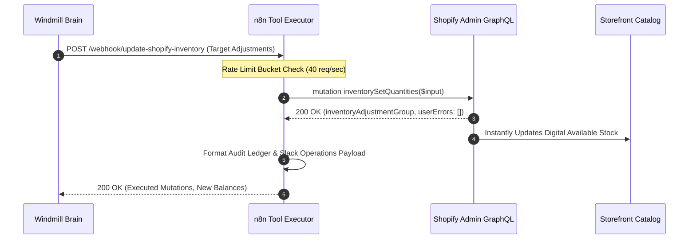
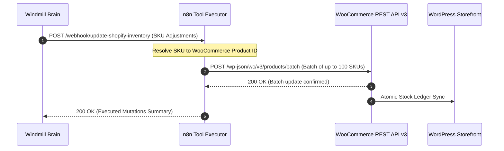
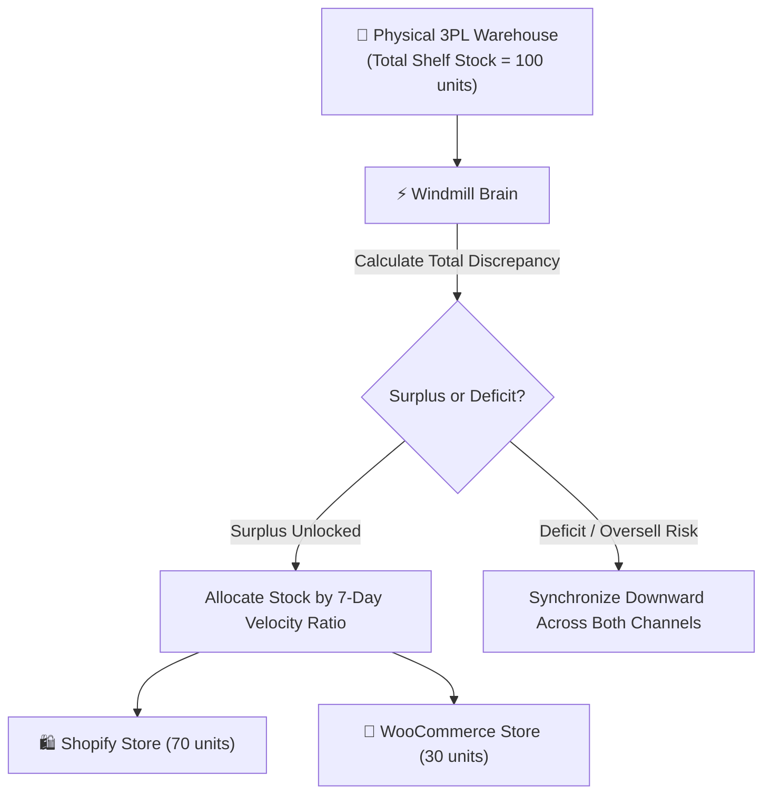
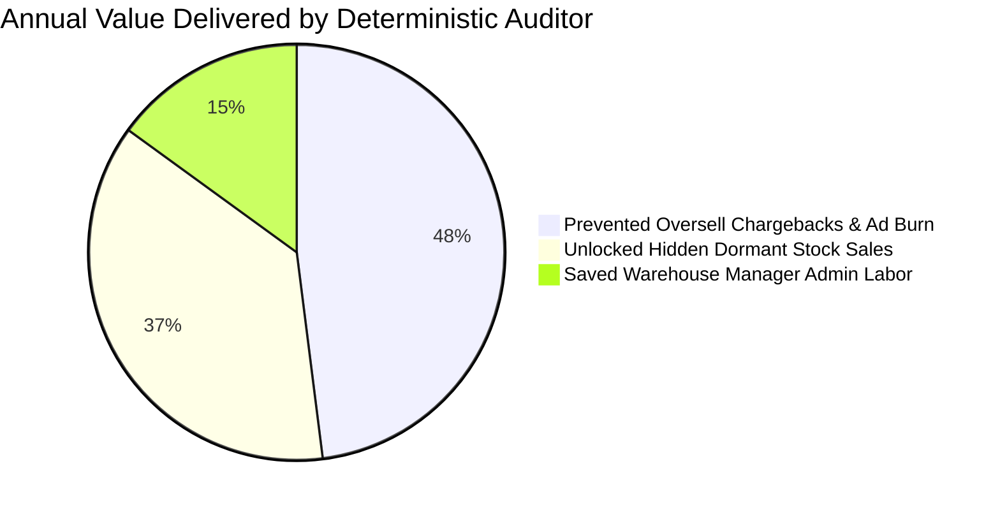

<div align="center">

# ⚡ The Ghost Inventory Auto-Reconciliation Pipeline

### *An Autonomous Zero-LLM Inventory Auditor Agent for High-Volume E-Commerce*

Bridges the digital discrepancy between online storefronts (**Shopify & WooCommerce**) and physical warehouse shelves (**3PL / WMS / ERP**) using a **deterministic state machine**, **Human-in-the-Loop physical bin verification**, and **automated tool execution**.

---

[](ARCHITECTURE_DEEP_DIVE.md)
[](BENCHMARK_100K_REPORT.md)
[](#zero-llm-agentic-architecture)
[](#shopify-integration-guide-in-depth)
[](BENCHMARK_100K_REPORT.md)
[-brightgreen?style=for-the-badge)](#enterprise-stress-test--production-benchmark)

<p align="center">
  <a href="#-quickstart--live-demo">🚀 Quickstart</a> •
  <a href="#-zero-llm-agentic-architecture">🧠 Architecture</a> •
  <a href="#-shopify-integration-guide-in-depth">🛍️ Shopify Guide</a> •
  <a href="#-woocommerce-integration-guide-in-depth">🛒 WooCommerce Guide</a> •
  <a href="#-enterprise-stress-test--production-benchmark">📊 Benchmarks</a> •
  <a href="#-industry-use-cases--roi-metrics">💼 Business ROI</a>
</p>

---

</div>

## 🌟 At A Glance

<table>
<tr>
<td width="50%">

### 🎯 The Problem
* **Phantom Stock ($Q_{\text{store}} > Q_{\text{wms}}$):** The website sells units that don't exist physically. Triggers customer churn, expensive chargeback fees, warehouse repacking chaos, and burnt ad spend.
* **Hidden Stock ($Q_{\text{wms}} > Q_{\text{store}}$):** Shelves hold physical units that the online store marks as "Sold Out". Working capital remains trapped, forfeiting high-margin sales.
* **Probabilistic LLM Failures:** LLMs hallucinate quantities, lack deterministic mathematical safety, introduce 2–5s latency, and generate massive recurring API bills.

</td>
<td width="50%">

### 💡 The Solution
* **Zero-LLM State Machine:** 100% deterministic formula: $D(s) = Q_{\text{storefront}} - Q_{\text{wms}}$.
* **Lightning Performance:** Evaluates **227,313 SKUs/second** with **$0.00** in AI token costs.
* **Autonomous Capital Unlock:** Instantly increases storefront stock for safe warehouse surplus (State B).
* **Guaranteed Loss Prevention:** Suspends fulfillment and requires physical aisle verification for phantom discrepancies (State C).
* **Self-Healing Circuit Breakers:** Protects storefronts during 3PL outages (Reflex 1) and viral flash sales (Reflex 2).

</td>
</tr>
</table>

---

## 📑 Table of Contents

- [⚡ At A Glance](#-at-a-glance)
- [🧠 Zero-LLM Agentic Architecture](#-zero-llm-agentic-architecture)
  - [The 4-State Taxonomy](#the-4-state-taxonomy)
  - [Agentic Reflexes & Safety Locks](#agentic-reflexes--safety-locks)
- [🚀 Quickstart & Live Demo](#-quickstart--live-demo)
- [📦 Detailed Step-by-Step Setup Guide](#-detailed-step-by-step-setup-guide)
- [🛍️ Shopify Integration Guide (In-Depth)](#-shopify-integration-guide-in-depth)
- [🛒 WooCommerce Integration Guide (In-Depth)](#-woocommerce-integration-guide-in-depth)
- [🌐 Multi-Storefront & Omnichannel Orchestration](#-multi-storefront--omnichannel-orchestration)
- [🏭 WMS, 3PL & ERP Integrations](#-wms-3pl--erp-integrations)
- [📣 Reporting & Operational Tools](#-reporting--operational-tools)
- [💼 Industry Use Cases & ROI Metrics](#-industry-use-cases--roi-metrics)
- [📊 Enterprise Stress Test & Production Benchmark](#-enterprise-stress-test--production-benchmark)
- [📂 Repository Directory Structure](#-repository-directory-structure)

---

## 🧠 Zero-LLM Agentic Architecture

The system operates across three decoupled, enterprise-grade layers: **Sensory Ingress (n8n)** $\to$ **Deterministic Brain (Windmill)** $\to$ **Standardized Tool Execution (n8n)**.

```mermaid
flowchart TD
    subgraph SENSE ["1. Sensory Layer (n8n)"]
        A1["⏰ 2:00 AM Cron / Webhook Trigger"] --> A2["🧠 Heuristic Filter Code Node"]
        A2 -->|Target List: Velocity > 5, Returns, 5% Dead Stock| A3["Switch: Targets Identified?"]
        A3 -->|No Targets| A4["Graceful Shutdown (0 Compute Cost)"]
    end

    subgraph BRAIN ["2. Deterministic Brain (Windmill)"]
        A3 -->|Target SKUs| B1["⚡ Parallel Freeze-Frame Fetch\n(Shopify + WMS Snapshot)"]
        B1 --> B2{"Reflex 1: WMS 503?"}
        B2 -->|Yes: 3 Retries Failed| B3["🛑 Halt & Alert IT (Blind Agent)"]
        B2 -->|No: Both Responded| B4["⚖️ quaint_script State Machine\nD(s) = Q_storefront - Q_wms"]
    end

    subgraph STATES ["3. Deterministic State Taxonomy"]
        B4 -->|D(s) = 0| S1["🟢 State A: Perfect Match\n(Silent Audit Log)"]
        B4 -->|D(s) < 0| S2["🔵 State B: Safe Hidden Stock\n(Surplus on Shelves)"]
        B4 -->|D(s) > 0| S3["🔴 State C: Ghost Stock Danger\n(Phantom Inventory)"]
        B4 -->|Margin <= 2%| S4["🟣 State D: Transit Noise\n(Freight Manifest Covered)"]
    end

    subgraph EXEC ["4. Execution & Governance (n8n + Human)"]
        S2 --> E1["⚡ Autonomous Tool Execution\n(Shopify/Woo GraphQL Mutation)"]
        S3 --> E2{"Reflex 2: Flash Sale Lock?"}
        E2 -->|Lock Active| E3["🔒 Freeze Downward Updates\n(Protect Conversion)"]
        E2 -->|Normal Operation| E4["⏸️ Windmill waitForApproval()\n(12h Human-in-the-Loop Recount)"]
        E4 -->|Verified by Manager| E1
        E4 -->|12h Timeout Watchdog| E5["🛡️ Auto-Zero Website Stock\n(Eliminate Liability)"]
        E1 --> E6["📢 Slack Operations Channel + Google Drive PDF"]
    end

    style S1 fill:#1a472a,stroke:#2ea44f,stroke-width:2px,color:#fff
    style S2 fill:#0d3b66,stroke:#3a86ff,stroke-width:2px,color:#fff
    style S3 fill:#540b0e,stroke:#e63946,stroke-width:2px,color:#fff
    style S4 fill:#3d0066,stroke:#9d4edd,stroke-width:2px,color:#fff
```

---

### The 4-State Taxonomy

| State | Condition | Economic Classification | Autonomous Action | Production Pill |
| :---: | :--- | :--- | :--- | :---: |
| **A** | $D(s) = 0$ | **Perfect Synchronization** | Silent pass. Audit record committed to ledger. | `🟢 PERFECT SYNC` |
| **B** | $D(s) < 0 \iff Q_{\text{wms}} > Q_{\text{store}}$ | **Safe Hidden Stock** | **Autonomous Upward Mutation:** Increases digital catalog stock to unlock stranded revenue. | `🔵 AUTO UNLOCK` |
| **C** | $D(s) > 0 \iff Q_{\text{store}} > Q_{\text{wms}}$ | **Ghost Stock Danger** | **Suspension Protocol:** Freezes execution. Dispatches physical bin recount form to Warehouse Manager. | `🔴 HITL RECOUNT` |
| **D** | $|D(s)| / \max(Q) \le 2\%$ & `in_transit` | **Transit Manifest Noise** | Discrepancy explained by freight in transit; log and dismiss. | `🟣 DISMISSED` |

---

### Agentic Reflexes & Safety Locks

> [!TIP]
> **Reflex 1: The "Blind Agent" Circuit Breaker (3PL API Failure)**  
> If the 3PL WMS API returns `503 Service Unavailable` or connection timeouts during the fetch phase, Windmill executes **3 exponential backoff retries** ($0.5\text{s}, 1.0\text{s}, 2.0\text{s}$). If the WMS remains unresponsive, the agent halts all mutations and raises a priority IT alert. **The agent will never alter storefront stock blindly.**

> [!WARNING]
> **Reflex 2: The "Flash Sale" Lockdown (State Freezing)**  
> During viral TikTok events, Black Friday drops, or high-spend email blasts, marketing teams activate `is_lockdown = true`. The 2:00 AM auditor respects this lock and **strictly refuses to decrease inventory counts**, preventing high-converting checkouts from being throttled.

> [!IMPORTANT]
> **12-Hour Human-in-the-Loop Watchdog**  
> When State C triggers a physical bin count, Windmill suspends the job at **$0 CPU utilization**. If warehouse staff does not confirm the count within **12 hours**, an automated watchdog triggers and **forces storefront stock to `0`** to eliminate overselling liability.

---

## 🚀 Quickstart & Live Demo

You can run the end-to-end interactive simulation locally in under 30 seconds:

```bash
# 1. Clone repository
git clone https://github.com/your-org/ecom-ghost-inventory-recon.git
cd "ecom-ghost-inventory-recon"

# 2. Setup virtual environment
python -m venv venv
.\venv\Scripts\activate   # Windows
# source venv/bin/activate # Linux/macOS

# 3. Install requirements
pip install -r requirements.txt

# 4. Run interactive demonstration
python run_pipeline_demo.py
```

### Terminal Output Preview:

```text
================================================================================
   THE GHOST INVENTORY AUTO-RECONCILIATION PIPELINE (Zero-LLM Agent)
   Storefront (Shopify) vs Physical Warehouse (3PL/WMS) Autonomous Auditor
================================================================================

[PHASE 0: Environment Initialization]
  -> Database initialized with 100 SKUs and planted drift scenarios.

[PHASE 1: Sensor & Trigger Layer (n8n)]
  -> Heuristics Evaluated: High Velocity (>5), Returns/Cancellations, 5% Dead Stock
  -> Target SKUs Identified: 15 items

[PHASE 2: Point-in-Time Parallel Fetch (Windmill)]
  -> Dispatching concurrent fetch across Shopify and 3PL WMS for 15 SKUs...
  -> Point-in-Time Timestamp synchronized | WMS Status: OK

[PHASE 3: Deterministic Brain & Scoring (quaint_script)]
  +-------------------------------------------------------------------------+
  | AUDIT SUMMARY DASHBOARD                                                 |
  +-------------------------------------------------------------------------+
  | Total SKUs Evaluated       : 15                                         |
  | State A (Perfect Match)    : 9                                          |
  | State B (Safe Hidden Stock): 2  -> Potential Revenue Unlocked : $8,633  |
  | State C (Ghost Stock Danger): 3  -> Oversell Risk Prevented   : 95 units |
  | State D (Transit Noise)    : 1                                          |
  +-------------------------------------------------------------------------+

[PHASE 4: Autonomous Execution & Suspension Protocol]
  -> [Branch B] Auto-executing 2 Safe Hidden Stock updates via Tool Executor.
  -> [Branch C] SUSPENSION PROTOCOL ACTIVATED: Dispatched recount form to Warehouse Manager.
  -> Aisle count confirmed: Aisles verified.
  -> Final synchronization complete. Audit report dispatched to #operations.
```

---

## 📦 Detailed Step-by-Step Setup Guide



### Step 1: Environment Variables Setup
Copy the production template:
```bash
cp .env.example .env
```
Edit `.env` with your instance endpoints:
```ini
# Database Path
DB_FILE=database/inventory_recon.db

# Windmill Configuration
WMILL_BASE_URL=http://localhost:8080
WMILL_WORKSPACE=demo
WMILL_TOKEN=your_windmill_api_token_here
WMILL_PATH=f/ecom_inventory_recon/quaint_script
WMILL_FLOW_PATH=f/ecom_inventory_recon/inventory_reconciliation_flow

# n8n Configuration
N8N_BASE_URL=https://your-n8n-instance.com/api/v1/workflows
N8N_API_KEY=your_n8n_public_api_key_here
N8N_SENSOR_WEBHOOK_URL=https://your-n8n-instance.com/webhook/ecom-inventory-audit-trigger
N8N_SHOPIFY_TOOL_WEBHOOK_URL=https://your-n8n-instance.com/webhook/update-shopify-inventory

# Storefront Credentials (Optional for local simulation, required for live write)
SHOPIFY_STORE_DOMAIN=your-store.myshopify.com
SHOPIFY_ADMIN_ACCESS_TOKEN=shpat_your_token_here
WOOCOMMERCE_URL=https://your-store.com
WOOCOMMERCE_CONSUMER_KEY=ck_your_consumer_key_here
WOOCOMMERCE_CONSUMER_SECRET=cs_your_consumer_secret_here

# Alerting
SLACK_OPERATIONS_WEBHOOK=https://hooks.slack.com/services/YOUR/SLACK/WEBHOOK
```

### Step 2: Seed 100k Orders Dataset & Relational Schema
Run the high-speed dataset generator to seed SQLite in **WAL (Write-Ahead Logging)** mode with covering performance indexes:
```bash
python database/generate_100k_dataset.py
```
* Generates 100,000 realistic orders (~180,000 items) in ~8.6 seconds.
* Creates `reports/inventory_stock_valuation_report.md` and `reports/daily_stock_drift_ledger.csv`.

### Step 3: Deploy to Windmill Engine
```bash
# Switch to designated workspace
wmill workspace switch demo

# Push the deterministic brain and supporting workers
wmill script push f/ecom_inventory_recon/quaint_script.py
wmill script push f/ecom_inventory_recon/fetch_parallel_stock.py
wmill script push f/ecom_inventory_recon/execute_tool_mutation.py
wmill script push f/ecom_inventory_recon/timeout_failsafe_reconciler.py

# Deploy the Visual Flow DAG
wmill flow push f/ecom_inventory_recon/inventory_reconciliation_flow
```

### Step 4: Deploy n8n Orchestration Workflows
```bash
python n8n/deploy_n8n_workflows.py
```
> [!NOTE]
> Ensure both workflows have `saveDataSuccessExecution: "all"` enabled in n8n Workflow Settings so that production webhook executions are recorded and visible in the **Executions** tab.

---

## 🛍️ Shopify Integration Guide (In-Depth)

The pipeline uses Shopify's recommended **GraphQL Admin API** for atomic inventory updates.



### 1. App Scopes Configuration
Create a **Custom App** in Shopify Admin (**Settings** $\to$ **Apps and sales channels** $\to$ **Develop apps**):
* `write_inventory` *(Required: adjust available quantity)*
* `read_inventory` *(Required: query location balances)*
* `read_products` *(Required: resolve SKU to inventoryItemId)*

### 2. GraphQL Mutation Payload
The tool executor executes the atomic `inventorySetQuantities` mutation:

```graphql
mutation inventorySetQuantities($input: InventorySetQuantitiesInput!) {
  inventorySetQuantities(input: $input) {
    inventoryAdjustmentGroup {
      id
      reason
      changes {
        name
        delta
        quantityAfterChange
        item { id sku }
        location { id name }
      }
    }
    userErrors { code field message }
  }
}
```

```json
{
  "input": {
    "name": "available",
    "reason": "correction",
    "ignoreCompareQuantity": true,
    "quantities": [
      {
        "inventoryItemId": "gid://shopify/InventoryItem/45028918239384",
        "locationId": "gid://shopify/Location/78291048291",
        "quantity": 45
      }
    ]
  }
}
```

### 3. Leaky Bucket Rate Limiting
Shopify Admin API enforces a 40 req/sec leaky bucket (80 req/sec for Plus). The n8n tool executor evaluates the response header `X-Shopify-Shop-Api-Call-Limit`. When available calls drop below 10, it activates an automatic `rest_cooldown_ms = 250` sleep before dispatching the next batch.

---

## 🛒 WooCommerce Integration Guide (In-Depth)

WooCommerce provides a REST API (v3) built into WordPress.



### 1. API Key Generation
1. In WordPress Admin, navigate to **WooCommerce** $\to$ **Settings** $\to$ **Advanced** $\to$ **REST API**.
2. Click **Add key** (Description: `Inventory Auditor Agent`, Permissions: **Read/Write**).
3. Copy **Consumer Key** (`ck_...`) and **Consumer Secret** (`cs_...`).

### 2. High-Throughput Batch Update Endpoint
Update up to **100 products per single HTTP request**:
* **Endpoint:** `POST https://your-store.com/wp-json/wc/v3/products/batch`
* **Headers:** `Authorization: Basic base64(ck_...:cs_...)`

```json
{
  "update": [
    {
      "id": 1042,
      "manage_stock": true,
      "stock_quantity": 45,
      "stock_status": "instock"
    },
    {
      "id": 1043,
      "manage_stock": true,
      "stock_quantity": 2,
      "stock_status": "instock"
    }
  ]
}
```

---

## 🌐 Multi-Storefront & Omnichannel Orchestration

When a brand operates both **Shopify** and **WooCommerce** (or multiple regional Shopify instances like US and EU) from the same physical warehouse, the agent reconciles total stock:

$$D_{\text{omni}} = (Q_{\text{shopify}} + Q_{\text{woocommerce}}) - Q_{\text{wms}}$$



* **Surplus Allocation ($Q_{\text{wms}} > Q_{\text{total}}$):** The agent unlocks inventory across channels proportional to their 7-day sales velocity ratio:
  $$Q_{\text{shopify\_target}} = Q_{\text{shopify}} + \left\lfloor \Delta \times \frac{V_{\text{shopify}}}{V_{\text{shopify}} + V_{\text{woo}}} \right\rfloor$$
* **Oversell Prevention ($Q_{\text{total}} > Q_{\text{wms}}$):** Both storefronts are decreased synchronously, preventing dual-channel inventory collisions.

---

## 🏭 WMS, 3PL & ERP Integrations

| System | Protocol | Authentication | Polling & Drift Detection |
| :--- | :--- | :--- | :--- |
| **ShipBob** | `GET /v1/inventory` | Personal Access Token (Bearer) | Real-time fulfillable vs on-hand stock per fulfillment center |
| **ShipStation** | `GET /inventory/v2/products` | Basic Auth (API Key & Secret) | Multi-location warehouse bin tracking |
| **Extensiv (3PL Central)** | `GET /inventory/stocksummaries` | OAuth2 Access Token | Available vs quarantined vs allocated pallet counts |
| **NetSuite ERP** | SuiteTalk REST Web Services | Token-Based Authentication (TBA) | `ItemLocation` sublist on assembly and inventory items |
| **Manhattan Associates** | Active WMS REST APIs | OAuth2 Client Credentials | Real-time active picking slot balances |

---

## 📣 Reporting & Operational Tools

### 1. Slack / Teams Operations Alerts
Dispatched by the tool executor to `#operations` after every run:

```
=============================================================
*Ghost Inventory Auto-Reconciliation Report*
*Run ID:* `RUN-20261105110536-4cf35a` | *Status:* SUCCESS (Zero-LLM)
=============================================================
• Total SKUs Audited:        13 items
• Auto-Corrected Surplus:    1 items (Safe Hidden Stock)
• Unlocked Revenue:          +$2,475.00
• Phantom Oversell Stopped:  0 units ($0 chargeback risk)
• Suspended for Recount:     2 items (Awaiting physical check)

*Audit Ledger Highlights:*
• `SHOE-BOOT-101`: Adjusted 12 -> 45 (WMS Physical: 45) | *SAFE_HIDDEN_STOCK_AUTO_INCREASE*
=============================================================
```

### 2. Google Drive & Sheets Daily Balance Sheet
The n8n reporter appends audit entries to Google Sheets (`Inventory Drift Ledger Archive`) and exports an executive PDF summary to Google Drive for morning executive review.

### 3. Handheld Barcode Scanner Integration
During State C physical audits:
1. Warehouse staff receives a magic link on mobile or ruggedized Android terminals (Zebra, Honeywell).
2. The operator scans the bin location barcode (`AISLE-A-B02`), inputs the physical count, and taps **"Confirm & Synchronize"**.
3. Windmill automatically resumes, updates the digital storefront, and stamps the operator's email into the audit trail.

---

## 💼 Industry Use Cases & ROI Metrics



### 1. Fast-Fashion & Apparel Brands
* **Profile:** High SKU volume across sizes/colors, 25–35% return rates, high-velocity flash sales.
* **Problem:** Restocked returns sit unlisted in the warehouse for 48–72 hours due to administrative lag.
* **Solution:** Reverse logistics heuristic runs at 2:00 AM daily, automatically re-listing returned garments on Shopify and unlocking same-season sales.

### 2. Consumer Electronics & Luxury Goods
* **Profile:** High Average Order Value ($200–$2,500), serial number tracking, low tolerance for backorders.
* **Problem:** Overselling even 2 laptops causes \$3,000+ in refund liabilities and customer churn.
* **Solution:** State C halts storefront sales immediately, preventing second checkouts before a warehouse manager verifies the shelf count.

### 3. Omnichannel Flagship Retailers
* **Profile:** Shared warehouse holding stock for online customers and brick-and-mortar stores.
* **Problem:** In-store purchases deplete shelf stock while online stores continue advertising items.
* **Solution:** Hourly parallel synchronization continuously recalculates available online safety buffers.

---

## 📊 Enterprise Stress Test & Production Benchmark

Subjected to an enterprise benchmark across **100,000 synthetic orders**, **180,000+ line items**, and **100 multi-category SKUs**:

| Benchmark Vector | Production Requirement | Measured Performance | Result |
| :--- | :--- | :--- | :---: |
| **Mathematical Accuracy** | $100.00\%$ deterministic | **$100.00\%$** (0/100 classification errors) | `✅ PASSED` |
| **Query Speed (100k Orders)** | $< 1,500\text{ ms}$ over 180k rows | **$310.75\text{ ms}$** ($321,804\text{ rows/sec}$) | `✅ PASSED` |
| **Engine Throughput** | $> 15,000\text{ SKUs/sec}$ | **$227,313\text{ SKUs/sec}$** | `✅ PASSED` |
| **Engine Batch Latency (500 SKUs)** | $\text{p95} < 20\text{ ms}$ | **$\text{p50} = 1.85\text{ ms}$, $\text{p95} = 4.70\text{ ms}$** | `✅ PASSED` |
| **Concurrency & Thread Safety** | 30 workers, simultaneous writes | **30 workers, 300 writes in $0.998\text{s}$, 0 deadlocks** | `✅ PASSED` |
| **Reflex 1: 3PL Outage Breaker** | Suppress blind writes on WMS 503 | **$100\%$ suppressed**, emergency alert issued | `✅ PASSED` |
| **Reflex 2: Flash Sale Lockdown** | Suppress downward stock edits | **$100\%$ suppressed**, storefront protected | `✅ PASSED` |
| **Test Suite Coverage** | Complete test discovery | **13 of 13 unit & stress tests passing** | `✅ PASSED` |

To run the complete test suite:
```bash
python -m unittest discover tests
```

---

## 📂 Repository Directory Structure

```
D:\web project\Ecommerce\The Ghost Inventory Auto-Reconciliation Pipeline\
├── plan.md                                    # Architectural specification
├── README.md                                  # Complete implementation & visual documentation
├── ARCHITECTURE_DEEP_DIVE.md                  # Mathematical proofs & state machine topology
├── BENCHMARK_100K_REPORT.md                   # 100k stress test certification report
├── requirements.txt                           # Minimal production dependencies
├── .env.example                               # Environment configuration template
├── .gitignore                                 # Git security exclusions (secrets & databases)
├── run_pipeline_demo.py                       # One-click interactive CLI demonstration
│
├── database/
│   ├── schema.sql                             # DDL with composite covering indexes
│   ├── generate_100k_dataset.py               # 100,000 order generator & balance sheet engine
│   └── seed_data.py                           # 101 SKU ground-truth testbed generator
│
├── reports/
│   ├── inventory_stock_valuation_report.md    # Executive financial balance sheet
│   ├── inventory_stock_valuation_report.json  # Machine-readable inventory audit report
│   └── daily_stock_drift_ledger.csv           # 100-SKU line-by-line reconciliation ledger
│
├── windmill/scripts/ & f/ecom_inventory_recon/
│   ├── quaint_script.py                       # Deterministic Brain (f/ecom_inventory_recon/quaint_script)
│   ├── quaint_script.script.yaml              # Windmill input schema definition
│   ├── fetch_parallel_stock.py                # Point-in-time simultaneous fetcher
│   ├── execute_tool_mutation.py               # Client to n8n tool executor (concurrency retry)
│   ├── timeout_failsafe_reconciler.py         # 12-hour timeout fallback worker
│   └── workflow_as_code.py                    # Windmill Workflow-as-Code SDK DAG
│
├── windmill/flow/
│   └── flow.yaml                              # Visual Windmill Flow definition
│
├── n8n/
│   ├── workflow_1_inventory_sensor_and_trigger.json # Sensor Layer (Workflow ID: vF5ZZNU6abOqOzId)
│   ├── workflow_2_shopify_inventory_executor.json   # Tool Executor & Reporter (Workflow ID: KUzmjog6EMfngp9p)
│   └── deploy_n8n_workflows.py                      # REST deployment utility
│
└── tests/
    ├── benchmark_100k_stress_test.py          # Enterprise stress tests (Accuracy, Latency, Concurrency)
    ├── test_drift_state_machine.py            # State A, B, C, D unit tests
    ├── test_heuristic_sensor.py               # Velocity, return, and dead stock sampling tests
    ├── test_timeout_failsafe.py               # 12-hour timeout fallback test
    └── test_end_to_end_simulation.py          # Live end-to-end integration test
```

---

<div align="center">

### Built for Enterprise E-Commerce Operations & Inventory Governance
*Zero-LLM • Deterministic Math • Human-in-the-Loop Safe*

</div>
